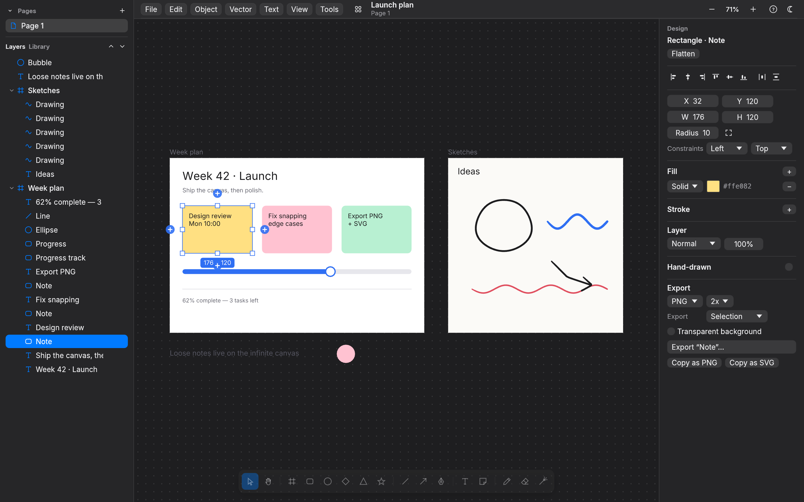
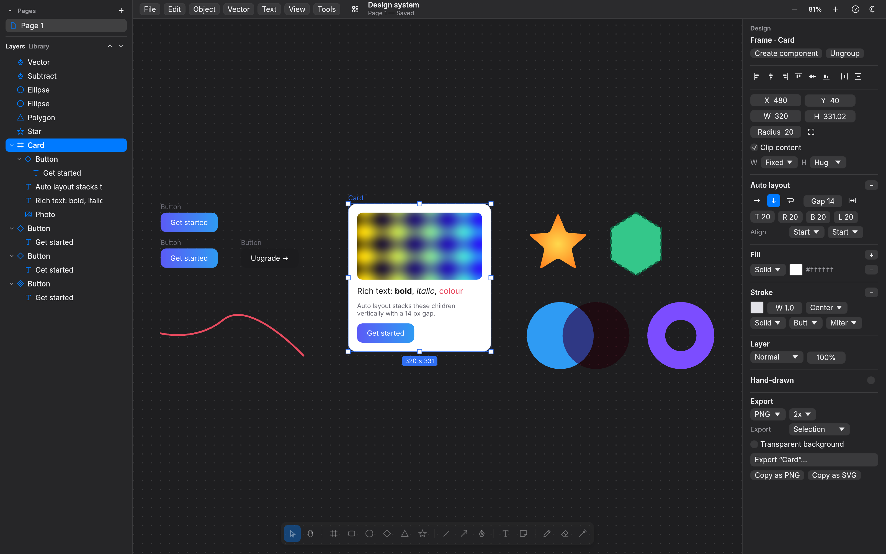
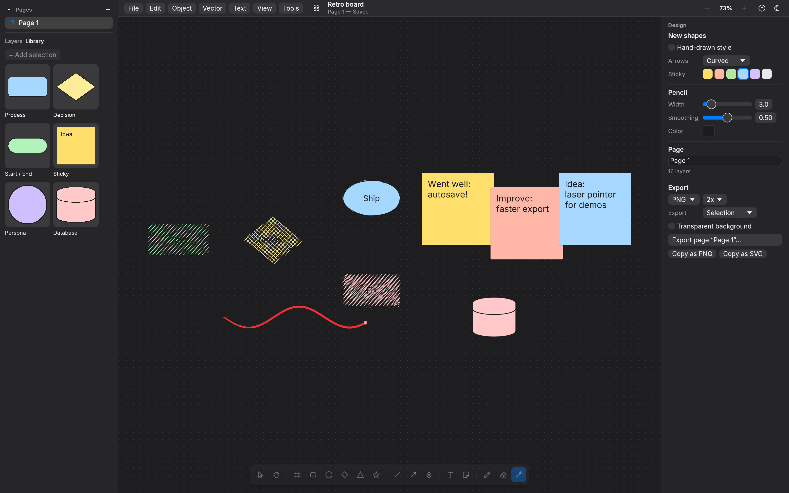

# Sketch

A native Rust infinite canvas for planning, working and sketching. It is modeled on the
behavior of [Paper](https://paper.design) and built clean-room on `wgpu` + `winit` + `egui`.



A local-first design and whiteboard tool. Projects are folders of pages; each page is an
infinite canvas with frames, groups, components and instances, auto layout and constraints,
vector paths and booleans, gradients and image fills, rich text, smart guides, and
pressure-sensitive ink — plus a whiteboard mode: hand-drawn (rough.js-style) shapes, arrows that
bind to shapes and re-route, elbow connectors, sticky notes, a laser pointer and a shape
library. Everything autosaves, and exports to PNG, SVG and PDF; Excalidraw files and SVG import.



> **Clean-room note.** `analysis/PAPER_ARCHITECTURE.md` documents how Paper Desktop 0.5.15 is
> put together, from a licensed install. The Electron package turned out to be a thin shell
> around the hosted web editor. Sketch re-implements *behavior* only. No Paper code,
> shaders, icons, fonts or assets are used or committed. The UI and canvas text use
> [Inter](https://rsms.me/inter/) 4.1 (SIL OFL 1.1), bundled in `assets/fonts/`.

## Reverse-engineered origin

Sketch is an independent, clean-room-style reimplementation. It was reverse engineered from
[Paper](https://paper.design) by studying the behavior of the Paper desktop app with
[REA](https://github.com/morluto/rea) and Claude Code. It is not affiliated with or endorsed by
Paper. No original Paper code or assets are included in this repository.

## Projects

Sketch opens on a **home screen** of your projects (recents grid with thumbnails, New, Import,
and Rename / Duplicate / Move to Trash from each card's ⋯ menu or right-click; restore from
Trash). Each project is a plain folder in `~/Documents/sketch-rs/<name>/` holding `project.json`
and one JSON file per page in `pages/`. Work is autosaved about a second after each change with
crash-safe atomic writes; files are versioned and older versions migrate on load. Set
`SKETCH_RS_HOME` to use another folder.

Sketch used to be called paper-rs. On first launch it moves `~/Documents/paper-rs` to
`~/Documents/sketch-rs`, and it still opens `.paper-rs` files and older libraries. The old
`PAPER_RS_*` environment variables still work when the matching `SKETCH_RS_*` one isn't set.

A project has any number of **pages** (Pages list at the top of the left sidebar: + to add,
double-click to rename, right-click to duplicate or delete, drag to reorder). Each page is its
own infinite canvas with its own undo history and view. Copy and paste works between pages and
between projects.

## Build and run

You need Rust 1.95 or newer (`rust-version` in `Cargo.toml`; the latest stable is recommended). Install it with [rustup](https://rustup.rs).

```sh
cargo build --release
./target/release/sketch-rs                  # projects home screen
./target/release/sketch-rs --demo           # sample planning board (not saved)
./target/release/sketch-rs ~/Documents/sketch-rs/Plan   # open a project folder
./target/release/sketch-rs board.sketch-rs   # open a Sketch 0.1 document
```

### macOS

The download is a universal app for Apple Silicon and Intel on macOS 11 or later, signed and
notarized. It checks for new releases once a day through [Sparkle](https://sparkle-project.org)
and offers to install them; Sketch › Check for Updates… checks at once. To build it yourself:

```sh
xcode-select --install          # command line tools (linker)
curl https://sh.rustup.rs -sSf | sh
cargo build --release && ./target/release/sketch-rs --demo
```

It uses Metal through wgpu. Shortcuts use ⌘, and trackpad pinch zooms.

`scripts/release-macos.sh` builds the universal `Sketch.app` with `sketch-rs-mcp` inside, signs
it with a Developer ID certificate, notarizes it and packages `Sketch.dmg`, plus the zip and
signed `appcast.xml` that installed copies update from. The one-time credential setup is at the
top of the script.

### Linux

```sh
# Debian/Ubuntu runtime libraries (usually already present on desktops)
sudo apt install libxkbcommon-x11-0 libxcb-xkb1 libvulkan1 mesa-vulkan-drivers
cargo build --release && ./target/release/sketch-rs --demo
```

It runs on X11 and Wayland through Vulkan, or GL as a fallback. Shortcuts use Ctrl. File
dialogs use the XDG desktop portal.

The desktop entry and the app icon live in `packaging/linux`. Install them into your home to get
a launcher entry and the Sketch icon in the taskbar and the Alt+Tab switcher:

```sh
scripts/install-linux-desktop.sh target/release/sketch-rs
```

The script takes the binary from the PATH when you leave the path out. The icons are rendered
from the brand icon in `site/scripts/brand/icon.svg`, the same one the Mac build uses, so rerun
`cargo run --example gen-linux-icons` after changing it.

### Headless (servers, CI)

No display is needed. wgpu renders offscreen, through Mesa lavapipe when there is no GPU:

```sh
sketch-rs --screenshot ui.png --demo --size 1440x900 --scale 2      # full UI
sketch-rs --screenshot home.png --home                              # projects home screen
sketch-rs --export-png out.png PROJECT_DIR --page 0 --scale 2 [--transparent]
sketch-rs --export-svg out.svg PROJECT_DIR
sketch-rs --export-pdf out.pdf PROJECT_DIR --frames                 # one PDF page per frame
sketch-rs --export out_dir PROJECT_DIR --format png --scope frames  # a folder of PNGs
sketch-rs --import board.excalidraw                                 # new project, prints its folder
```

## AI agents (MCP)


Sketch serves the [Model Context Protocol](https://modelcontextprotocol.io) while it runs, so
agents such as Claude Code and Codex can read and design on the open canvas, the way Paper's
own MCP server works (behaviour notes: `analysis/paper-mcp.md`). Every tool call runs through
the editor like a user edit: one undo step per call, and the window repaints immediately.

* **Streamable HTTP** (built into the app): `http://127.0.0.1:29980/mcp`. Paper uses 29979, so
  both can run. Loopback only; requests from browsers (with an `Origin` header) and foreign
  `Host` headers are rejected. `SKETCH_RS_MCP_PORT=NNNN` changes the port; `SKETCH_RS_MCP=0`
  turns the server off.
* **stdio**: `sketch-rs-mcp` (built next to `sketch-rs`, and in the Mac download at
  `/Applications/Sketch.app/Contents/MacOS/sketch-rs-mcp`) relays stdio to the running app. It
  lists the tools even when the app is closed, and tells the agent to start Sketch if a
  call can't reach it.

### Claude Code

```sh
# HTTP (the app must be running)
claude mcp add --transport http --scope user sketch http://127.0.0.1:29980/mcp
# or stdio through the bridge
claude mcp add --scope user sketch -- /path/to/paper-rs/target/release/sketch-rs-mcp
```

### Codex

```sh
# HTTP
codex mcp add sketch --url http://127.0.0.1:29980/mcp
# or stdio
codex mcp add sketch -- /path/to/paper-rs/target/release/sketch-rs-mcp
```

which writes this to `~/.codex/config.toml` (either form works):

```toml
[mcp_servers.sketch]
url = "http://127.0.0.1:29980/mcp"
# command = "/path/to/paper-rs/target/release/sketch-rs-mcp"
```

Then ask the agent something like *"In Sketch, create a 390×844 mobile artboard and design a
sign-in screen"*, or *"draw a flowchart of our deploy process on a new page, hand-drawn
style"*.

### Tools

Names and arguments follow Paper's MCP server where Sketch has an equivalent, so prompts
written for Paper work here too.

| Group | Tools |
|---|---|
| Projects & pages | `list_resources`, `open_file`, `create_file`, `create_page`, `rename_pages` |
| Read | `get_basic_info`, `get_selection`, `get_node_info`, `get_children`, `get_tree_summary`, `get_computed_styles`, `get_jsx`, `find_nodes`, `get_fill_image`, `get_font_family_info`, `get_guide` |
| See | `get_screenshot` (PNG image content of a node or the page), `export` (PNG/SVG/PDF files), `export_combined_pdf` |
| Write | `create_artboard`, `write_html`, `update_styles`, `set_text_content`, `rename_nodes`, `duplicate_nodes`, `move_nodes`, `delete_nodes`, `finish_working_on_nodes` (saves) |
| Sketch extras | `create_shape` (rectangles, ellipses, diamonds, stars, stickies, text, lines, arrows bound to shapes), `select_nodes`, `undo`, `redo` |

`write_html` takes HTML with inline styles: flexbox (`display:flex`, direction, gap, padding,
alignment, `flex-grow`, wrap) and block stacking map onto auto layout with CSS's stretch rules;
text gets size, weight, italic, color, line height, letter spacing, alignment and rich-text
runs (`<b>`, `<i>`, `<span style>`); boxes get backgrounds (colors, gradients, images),
borders, radii, opacity and blend modes; `` takes local paths or `data:` URIs and `<svg>`
is imported as vectors. `update_styles` takes the same CSS as JSON, plus the hand-drawn keys
`sketch`, `roughness`, `fillStyle`, `strokeStyle`. Node ids look like `3fa9c1:14` (page and
node); `pageId` lets an agent work on another page without switching the user's view.

## Tests

```sh
cargo test                                # ~140 tests: unit, scenario, headless GPU, CLI
SKETCH_RS_REQUIRE_GPU=1 cargo test         # fail (instead of skip) when no GPU adapter exists
cargo test --release --test perf -- --nocapture   # 10k-element frame timings
```

* **Unit tests** cover geometry, vector paths, the rough.js port (compared with real
  rough.js 4.6.4 output), auto layout and constraints, booleans, rich text spans, the elbow
  router, formats and migrations, atomic writes, the project store, PDF structure, Excalidraw
  and SVG import, the palette's fuzzy matching and the shortcut table.
* **Scenario tests** drive the editor with synthetic pointer and keyboard events:
  `src/editor/tests.rs` (core editing), `tests/projects.rs` (projects, autosave, pages),
  `tests/figma.rs` (groups, components, auto layout, constraints, pen, booleans, rich text,
  guides), `tests/excalidraw.rs` (hand-drawn style, arrows, quick-connect, stickies, laser,
  library), `tests/workflow.rs` (layers drag, palette, shortcuts), `tests/io.rs` (export,
  import, clipboard, CLI), `tests/mcp.rs` (every MCP tool on a headless session, then an rmcp
  client over HTTP and through the `sketch-rs-mcp` stdio bridge).
* **Headless GPU tests** render through wgpu, assert pixels and write the screenshots below.
  One rasterizes the SVG export with resvg and compares it with the GPU render; one renders
  the PDF export with pdftoppm when installed.

| Milestone | Screenshot(s) in `docs/screenshots/` |
|---|---|
| 1. Local projects | `milestone1_home.png`, `milestone1_trash.png` |
| 2. Pages | `milestone2_pages.png` |
| 3. Figma core | `milestone3_figma_core.png`, `milestone3_canvas.png` |
| 4. Excalidraw core | `milestone4_whiteboard.png` |
| 5. Inspector, palette, shortcuts | `milestone5_inspector.png`, `milestone5_palette.png`, `milestone5_shortcuts.png` |
| 6. Import / export | `milestone6_pdf_page.png` (PDF rasterized by pdftoppm), `milestone6_excalidraw_import.png`, `milestone6_svg_import.png` |
| 7. MCP server | `milestone7_mcp.png` (a screen written through `write_html`, captured with `get_screenshot`), `milestone7_mcp_live_xvfb.png` (the live app after Claude Code drew into it over the stdio bridge) |
| Sketch 0.1 | `m1_*` … `m6_*`, `app_demo.png`, `x11_window_xvfb.png` |

## Using it



The tools sit in the floating bar at the bottom of the canvas. Select a layer to edit it in
the **Design** panel on the right. The **Layers** panel on the left shows the tree: click to
select, Shift-click to add, double-click to rename, and use 👁 / 🔒 to hide or lock. The
**Up/Down** buttons reorder.

* Draw a frame around existing shapes and it adopts them. Shapes drawn inside a frame become
  its children, and dragging a layer into or out of a frame re-parents it.
* Top-level frames that contain content act as canvas regions. Drag from their body to
  marquee-select inside them, and drag the frame by its name label.
* The pencil keeps a constant on-screen width at any zoom. With nothing selected, set width,
  smoothing and color in the Design panel.
* Hold ⌘/Ctrl while dragging to suspend snapping.

### Keyboard shortcuts

⌘ on macOS, Ctrl on Linux and Windows. Press `?` or ⌘/ in the app for the full grouped list
(100+ bindings), or ⌘K to search every command.

| Keys | Action | Keys | Action |
|---|---|---|---|
| V / 1 | Select | ⌘K | Command palette |
| H, or hold Space | Hand (pan) | ⌘Z / ⌘⇧Z | Undo / redo |
| F or A | Frame | ⌘G / ⌘⇧G | Group / ungroup |
| R / 2, O / 4, D / 3 | Rectangle, ellipse, diamond | ⌘⌥G | Frame selection |
| ⇧Y, ⇧S | Polygon, star | ⌘⌥K / ⌘⌥B | Create component / detach |
| L / 6, ⇧L / 5 | Line, arrow | ⇧A / ⌥⇧A | Add / remove auto layout |
| P, ⇧P / 7 | Pen, pencil | ⌥A ⌥H ⌥D / ⌥W ⌥V ⌥S | Align left/center/right, top/middle/bottom |
| T / 8, S | Text, sticky note | ⌥⇧H / ⌥⇧V | Distribute spacing |
| K | Laser pointer | ⌥⇧U S I E | Union, subtract, intersect, exclude |
| E / 0 | Eraser | ⌘E | Flatten |
| 9, ⌘⇧K | Place image | ⌘B / ⌘I / ⌘U / ⌘⇧X | Bold, italic, underline, strikethrough |
| Enter / ⇧Enter | Edit (text, path) / select parent | ⌘⌥H | Hand-drawn style |
| Tab / ⇧Tab | Next / previous sibling | ⇧H / ⇧V | Flip |
| ⌥-drag | Duplicate while dragging | ⌘⌥C / ⌘⌥V | Copy / paste properties |
| ⌥ hover | Measure distances | ⌘R | Rename |
| ⌘= / ⌘- / ⇧0 | Zoom in / out / 100% | ⇧1 / ⇧2 | Zoom to fit / selection |
| PageUp / PageDown | Previous / next page | ⌘\\ | Show / hide UI |

## Feature parity: Paper / Figma / Excalidraw vs Sketch

Columns 2–4 say whether each product has the feature (✓) and where the behavior was learned:
Paper from its desktop shell and public docs (`analysis/PAPER_ARCHITECTURE.md`), Figma from
public docs (`analysis/FIGMA_NOTES.md`), Excalidraw from its MIT source
(`analysis/EXCALIDRAW_NOTES.md`). The last column is Sketch: ✅ done, ⚠️ partial (see
Known gaps), ⏳ planned in a later milestone, ❌ not planned.

| Feature | Paper | Figma | Excalidraw | Sketch |
|---|---|---|---|---|
| Local projects, recents grid, trash | (cloud dashboard) | ✓ (cloud) | (single file) | ✅ Folders in `~/Documents/sketch-rs`, thumbnails, rename/duplicate/trash/restore |
| Autosave, crash-safe, versioned files | ✓ (cloud) | ✓ (cloud) | ✓ (browser storage) | ✅ 1 s autosave, atomic writes, migration chain (page v1→v3) |
| Pages, infinite canvas per page | ✓ | ✓ | – | ✅ Per-page history and camera, reorder/duplicate/delete |
| Frames with clipping | ✓ | ✓ | ✓ | ✅ ⚠️ clip is rectangular (corner radius not clipped) |
| Groups | ✓ | ✓ | ✓ | ✅ Bounds follow children, click selects group, double-click enters, scale on resize |
| Components, instances, overrides | – | ✓ | (library only) | ✅ Live sync, per-property overrides, reset, detach, go to main |
| Auto layout (direction, gap, padding, hug/fill/fixed, wrap) | ✓ (flexbox) | ✓ | – | ✅ Drag-reorder in flow, space-between, absolute children |
| Constraints | – | ✓ | – | ✅ Left/right/stretch/center/scale per axis, ⌘ to ignore |
| Pen tool, vector point editing | ✓ | ✓ | – | ✅ Corner/smooth points, handles (⌥ breaks), close, delete, toggle |
| Boolean ops (union/subtract/intersect/exclude), flatten | (roadmap) | ✓ | – | ✅ ⚠️ destructive (result is a path, curves flattened) |
| Gradients (linear, radial) | ✓ | ✓ | – | ✅ Multi-stop, angle, radius; ⚠️ no on-canvas gradient handles |
| Image fills | ✓ | ✓ | ✓ (image element) | ✅ Fill/fit/stretch/tile, place image (⌘⇧K), drag-and-drop, stored in project |
| Strokes: width, align, dash, caps, joins | ✓ | ✓ | ✓ | ✅ |
| Corner radius (per corner), polygons, stars | ✓ | ✓ | – | ✅ |
| Opacity, blend modes | ✓ | ✓ | ✓ (opacity) | ✅ ⚠️ canvas renders 5 modes exactly, all 16 exact in SVG |
| Rich text (per-range bold/italic/size/colour) | ✓ | ✓ | – | ✅ Plus underline, strikethrough, line height, letter spacing |
| Align / distribute | ✓ | ✓ | ✓ | ✅ ⌥A/D/W/S/H/V, ⌥⇧H/V |
| Smart guides, spacing, measurement | ✓ | ✓ | – | ✅ Edge/center snap, equal spacing, ⌥-hover distances |
| Hand-drawn (rough) style per element | – | – | ✓ | ✅ rough.js 4.6.4 port, verified against rough.js output; sloppiness, fill styles |
| Bound arrows, elbow arrows, quick shapes, sticky notes | – | (FigJam) | ✓ | ✅ Orbit binding that follows shapes, straight/curved/elbow, 5 heads, diamond, quick-connect, stickies |
| Laser pointer, shape library | – | (FigJam) | ✓ | ✅ Fading laser trail; shared library with starter items |
| Inspector, layers drag-reorder, command palette (⌘K) | ✓ | ✓ | ✓ | ✅ Sectioned inspector, tree drag above/below/into, fuzzy palette over actions, pages, layers, library |
| Export PNG / SVG / PDF of selection, frame, page | ✓ | ✓ | ✓ (PNG/SVG) | ✅ Selection, each frame, page or all pages; vector PDF with gradients, images, blend modes; copy as PNG/SVG |
| Import .excalidraw / SVG, copy-paste across projects | – | ✓ (SVG) | ✓ | ✅ .excalidraw scenes, .excalidrawlib libraries, SVG (paths, gradients, images, text), system clipboard between pages, projects and apps |
| Freehand ink with pressure | – | (pencil) | ✓ | ✅ Smoothing, pressure, eraser |
| MCP server for AI agents | ✓ | ✓ (Dev Mode) | ✓ (community) | ✅ Streamable HTTP in the app + stdio bridge; Paper-compatible tool names, `write_html`, screenshots, whiteboard shapes |
| Multiplayer, cloud sync, plugins | ✓ | ✓ | ✓ | ❌ local-first by design |

## Known gaps

* **Paper's document model is HTML/CSS.** Sketch uses geometric nodes with flexbox-like auto
  layout on frames; there are no variables, CSS export or code generation.
* **Rendering approximations.** Frame clipping is a rectangle (scissor), so rounded frames
  don't clip their corners. Group opacity multiplies into children instead of compositing the
  group. Overlay, color dodge/burn, hard/soft light, difference, exclusion, hue, saturation,
  color and luminosity blend as Normal on the canvas (they are exact in SVG export).
* **Booleans are destructive**: the result is a new vector path with flattened curves.
  Gradients are edited in the inspector only.
* **macOS testing is thin.** The notarized universal build runs on an M4 Pro Mac under the
  hardened runtime. The window opens on Metal, Sparkle loads, MCP edits land and autosave
  writes them. Mouse, trackpad and keyboard input, the menus, Sparkle's update window and the
  Intel slice haven't been tested on a Mac. On Linux, the real window was exercised under Xvfb;
  the screenshot is `x11_window_xvfb.png`.
* **Pen pressure.** winit 0.30 does not expose tablet pressure for pen events that arrive as
  mouse input, which is common with macOS and Wacom tablets. Pressure comes from touch/pen
  `force` when the platform reports it. Otherwise it is simulated from stroke velocity.
* **Text** uses Inter (regular, bold, italic, bold italic) with no shaping, so there are no
  ligatures, complex scripts or RTL, and no font picker. IME preedit is not displayed
  (committed text works).
* **No rotation.** Nodes are axis-aligned boxes; rotated imports are baked into paths.
* **Undo granularity.** Document renames from the Design panel are not undoable, and the
  selection is not part of history.
* **Performance.** Nodes are tessellated once per zoom octave and cached; unchanged frames
  reuse the previous item list and GPU buffers, so panning uploads nothing. With 10k visible
  nodes a cached frame takes ~3 ms (release, `tests/perf.rs`); the first frame at a new zoom
  octave takes ~140 ms on a CPU. Not tuned for 100k+.
* **PDF**: text is outlined (not selectable); gradient stop transparency uses the first
  stop's alpha; tiled image fills are drawn as repeated images.
* **Import**: Excalidraw rotation is baked into paths (text rotation is dropped), bound text
  inside shapes stays a separate text layer (except sticky notes), and fonts map to Inter.
  SVG patterns, filters, masks and clip paths are not imported.
* **MCP**: one project is open at a time, so `fileId` must name the open project (call
  `open_file` to switch; the user's window switches too). No design tokens, comments or AI
  image generation (Paper has them). Moving or duplicating layers between pages isn't
  supported. Remote `http(s)` images aren't fetched; pass a local path or a `data:` URI.
  CSS margin, grid, shadows and transforms are reported back as ignored styles.
* **Linux file dialogs** need an XDG desktop portal. Without one, Save/Open dialogs return
  nothing. The headless CLI is unaffected.

## Project layout

```
src/geom.rs        vectors, rects, camera
src/vector.rs      bezier paths: flatten, hit test, SVG data, shapes, dashes
src/model/         Node / NodeKind / paints / Document arena
src/history.rs     transactions, undo/redo
src/layout.rs      auto layout, constraints, group bounds
src/ink.rs         stroke smoothing, pressure, outline
src/text.rs        rich text layout and glyph outlines
src/assets.rs      image registry (content-hashed)
src/project/       project store, manifest/page formats, migrations
src/session.rs     open project, autosave, thumbnails
src/editor/        tools, structure (groups/components), vector ops, pages, text editing
src/render/        draw ops → cached meshes → wgpu; headless capture
src/io/            PNG, SVG, PDF, export scopes, Excalidraw + SVG import, clipboard,
                   atomic writes
src/connector.rs   arrow bindings, elbow router, arrowheads
src/library.rs     shared shape library
src/ui/            home screen, pages, layers, inspector
src/app.rs         winit application
src/mcp/           MCP server (rmcp): tools, HTML/CSS mapping, HTTP service
src/bin/sketch-rs-mcp.rs  stdio bridge to the running app
analysis/          reverse-engineering findings and design (raw dumps are gitignored)
docs/screenshots/  headless renders produced by `cargo test`
site/              the download page (SvelteKit on Vercel); see site/README.md
AGENTS.md          workflow for coding agents; its skills live in .agents/skills/
```

## License

MIT OR Apache-2.0 for the code in this repository. Inter (Regular, Medium, SemiBold) is
© The Inter Project Authors under the SIL Open Font License 1.1; see `assets/fonts/OFL.txt`.
The agent skills in `.agents/skills/` keep their own licenses; see `THIRD_PARTY.md`.
